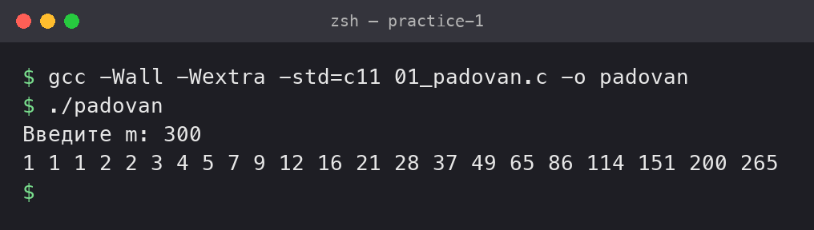
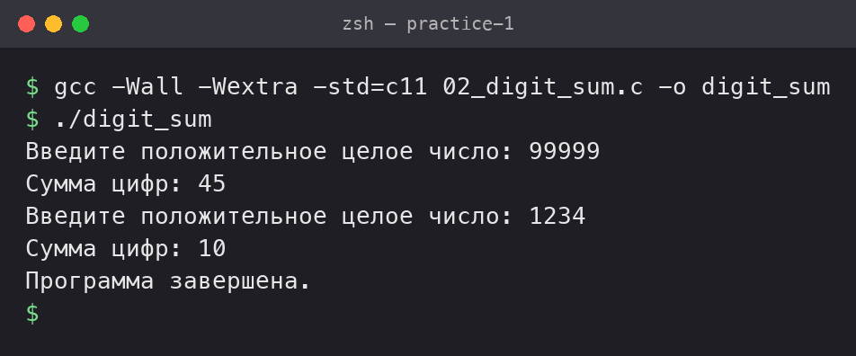
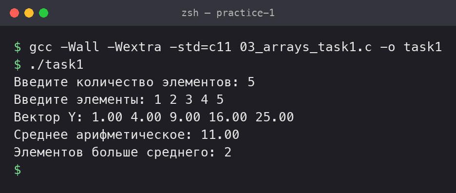
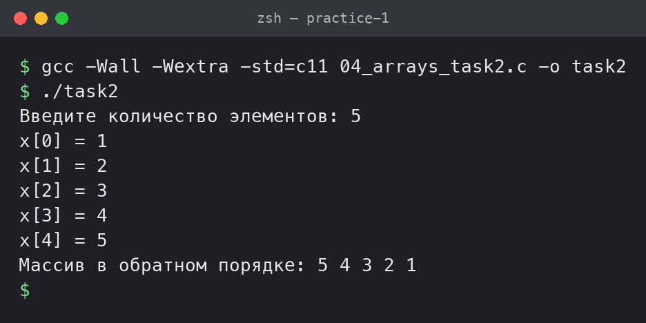
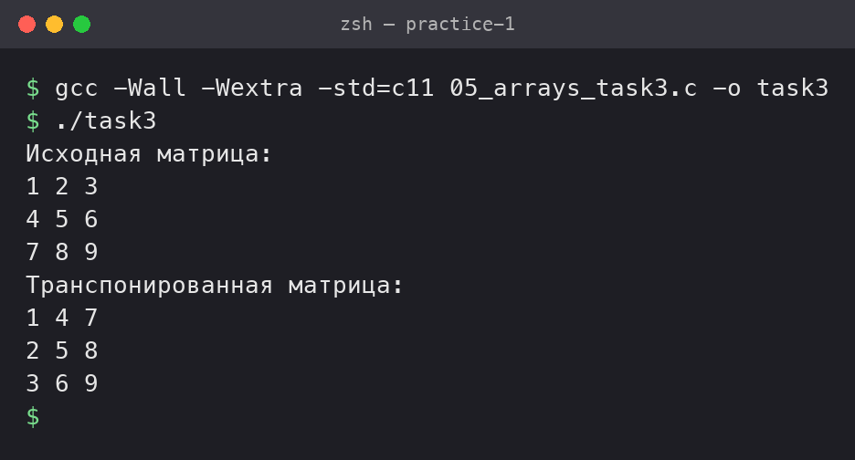
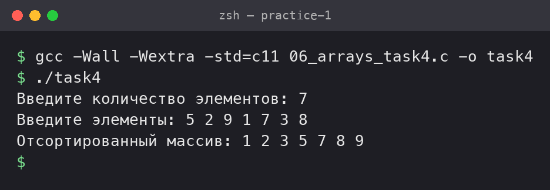
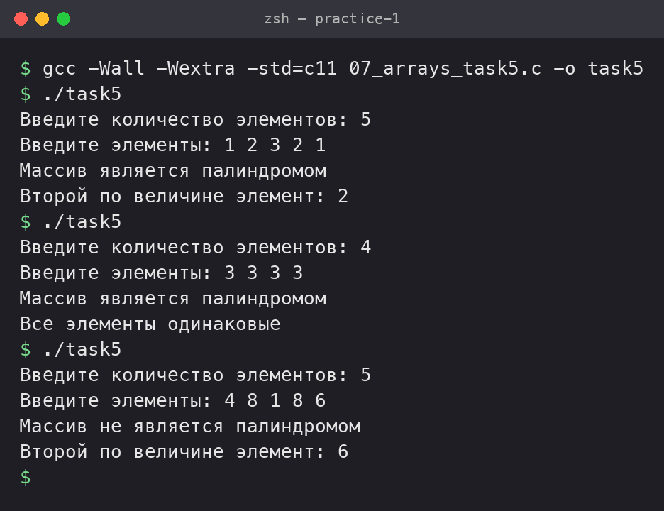

# Практическая работа №1

## Тема: Циклы, условия и массивы в языке C

---

## Задача 1. Числовые последовательности

### Постановка задачи

Организовать и распечатать последовательность чисел Падована, не превосходящих число m, введённое с клавиатуры. Числа Падована представлены следующим рядом:

1, 1, 1, 2, 2, 3, 4, 5, 7, 9, 12, 16, 21, 28, 37, 49, 65, 86, 114, 151, 200, 265, ...

Использовать конструкцию `for` и простые варианты условной конструкции `if else`. Для этих чисел заданы формулы:

P(0) = P(1) = P(2) = 1, P(n) = P(n-2) + P(n-3)

**Замечания:**

- **Важно.** Нельзя первые числа последовательности просто распечатывать на экране как строки — это не решение задачи, даже если первые три числа — единицы.

**Дополнительная информация:**

- Числа Падована имеют отношение к пластическому числу или "пластическому сечению", тогда как более известные числа Фибоначчи связаны с "золотым сечением".
- Подробнее о числах Падована можно прочитать в статье Википедии.
- Видеообъяснение чисел Падована: "The Plastic Ratio - Numberphile" на YouTube.

### Математическая модель

P(0) = P(1) = P(2) = 1, P(n) = P(n-2) + P(n-3).

Первые три числа равны 1. Каждое следующее число это сумма чисел, стоящих на 2 и на 3 места раньше. Я храню три последних числа в переменных `a`, `b`, `c`, считаю новое число `p = a + b` и сдвигаю переменные. Цикл останавливается, когда число становится больше `m`.

### Список идентификаторов

| Имя переменной | Тип данных | Описание |
|---|---|---|
| `m` | `int` | Число, вводится с клавиатуры |
| `n` | `int` | Номер числа в последовательности |
| `a`, `b`, `c` | `int` | Три предыдущих числа |
| `p` | `int` | Текущее число Падована |

### Код программы

```c
#include <stdio.h>

int main() {
    int m;
    int a = 1, b = 1, c = 1, p;

    printf("Введите m: ");
    scanf("%d", &m);

    for (int n = 0; ; n++) {
        if (n < 3) {
            p = 1;
        } else {
            p = a + b;
            a = b;
            b = c;
            c = p;
        }

        if (p > m) {
            break;
        }
        printf("%d ", p);
    }
    printf("\n");

    return 0;
}
```

### Результаты работы программы



---

## Задача 2. Сумма цифр положительного числа

### Постановка задачи

С клавиатуры вводится произвольное целое положительное число, считается сумма его цифр. Если сумма цифр числа больше 10, то вводится следующее число, если сумма меньше либо равна 10 — программа завершается.

**Математические операции:**

- Для разбиения числа на цифры используйте **целочисленное деление** и операцию получения **остатка от деления** в языке C.
  - **Целочисленное деление** (`/`): при делении целых чисел результат является целым числом без остатка.
  - **Остаток от деления** (`%`): возвращает остаток от деления одного целого числа на другое.
- При работе с произвольным числом необходимо реализовать цикл для последовательного извлечения всех цифр числа.

**Алгоритм программы:**

1. **Ввод числа:**
   - Ввести положительное целое число `num` с клавиатуры.
   - Проверить, что `num` положительное.
2. **Вычисление суммы цифр:**
   - Инициализировать переменную `sum` нулём.
   - Пока `num` больше нуля:
     - Добавить к `sum` остаток от деления `num` на `10` (последняя цифра числа).
     - Разделить `num` на `10` без остатка (убрать последнюю цифру).
3. **Проверка суммы цифр:**
   - Если сумма цифр `sum` больше `10`, повторить ввод следующего числа (перейти к шагу 1).
   - Если сумма цифр `sum` меньше либо равна `10`, завершить программу.

**Пример работы программы:**

```
Введите положительное целое число: 1234
Сумма цифр: 10
Программа завершена.
```

**Дополнительно:**

- Убедитесь, что в цикле правильно обновляете значение `num`, чтобы избежать бесконечного цикла.
- Можно оформить ввод и проверку в цикле `do...while`, чтобы повторять ввод до тех пор, пока не будет выполнено условие завершения программы.

### Математическая модель

Последняя цифра числа это `num % 10`, а `num / 10` убирает последнюю цифру. Повторяем, пока число не станет 0, и складываем цифры в `sum`.

Ввод повторяется, пока `sum > 10`, поэтому используется цикл `do...while`. Если введено не положительное число, выводится сообщение и ввод повторяется.

### Список идентификаторов

| Имя переменной | Тип данных | Описание |
|---|---|---|
| `num` | `int` | Введённое число |
| `sum` | `int` | Сумма цифр |

### Код программы

```c
#include <stdio.h>

int main() {
    int num, sum;

    do {
        printf("Введите положительное целое число: ");
        scanf("%d", &num);

        if (num <= 0) {
            printf("Число должно быть положительным!\n");
            sum = 11;
        } else {
            sum = 0;
            while (num > 0) {
                sum = sum + num % 10;
                num = num / 10;
            }
            printf("Сумма цифр: %d\n", sum);
        }
    } while (sum > 10);

    printf("Программа завершена.\n");
    return 0;
}
```

### Результаты работы программы



---

## Массивы, задача 1

### Постановка задачи

Для заданного числового вектора X, введённого с клавиатуры, выполнить следующие действия:

1. Вычислить вектор Y, где каждый элемент yi = xi^2.
2. Найти среднее арифметическое элементов вектора Y.
3. Определить количество элементов вектора Y, превышающих найденное среднее значение.

### Математическая модель

y[i] = x[i] * x[i]. Среднее = (сумма всех y[i]) / n.

Сначала считаю `Y` и сумму, потом среднее. Затем ещё одним циклом считаю, сколько элементов `Y` больше среднего.

### Список идентификаторов

| Имя переменной | Тип данных | Описание |
|---|---|---|
| `n` | `int` | Количество элементов |
| `x` | `float[100]` | Вектор X |
| `y` | `float[100]` | Вектор Y |
| `sum` | `float` | Сумма элементов Y |
| `avg` | `float` | Среднее арифметическое |
| `count` | `int` | Сколько элементов больше среднего |
| `i` | `int` | Счётчик цикла |

### Код программы

```c
#include <stdio.h>

int main() {
    int n;
    float x[100], y[100];
    float sum = 0, avg;
    int count = 0;

    printf("Введите количество элементов: ");
    scanf("%d", &n);

    printf("Введите элементы: ");
    for (int i = 0; i < n; i++) {
        scanf("%f", &x[i]);
    }

    for (int i = 0; i < n; i++) {
        y[i] = x[i] * x[i];
        sum = sum + y[i];
    }
    avg = sum / n;

    for (int i = 0; i < n; i++) {
        if (y[i] > avg) {
            count++;
        }
    }

    printf("Вектор Y: ");
    for (int i = 0; i < n; i++) {
        printf("%.2f ", y[i]);
    }
    printf("\n");
    printf("Среднее арифметическое: %.2f\n", avg);
    printf("Элементов больше среднего: %d\n", count);

    return 0;
}
```

### Результаты работы программы



---

## Массивы, задача 2

### Постановка задачи

Для некоторого числового массива X, введённого с клавиатуры поэлементно, изменить порядок элементов на обратный и распечатать результат на экране.

### Математическая модель

Меняю местами первый и последний элемент, второй и предпоследний и так далее до середины массива. Для элемента `i` парой будет элемент `n - 1 - i`. Обмен делается через переменную `temp`.

### Список идентификаторов

| Имя переменной | Тип данных | Описание |
|---|---|---|
| `n` | `int` | Количество элементов |
| `x` | `int[100]` | Массив X |
| `temp` | `int` | Временная переменная для обмена |
| `i` | `int` | Счётчик цикла |

### Код программы

```c
#include <stdio.h>

int main() {
    int n;
    int x[100];
    int temp;

    printf("Введите количество элементов: ");
    scanf("%d", &n);

    for (int i = 0; i < n; i++) {
        printf("x[%d] = ", i);
        scanf("%d", &x[i]);
    }

    for (int i = 0; i < n / 2; i++) {
        temp = x[i];
        x[i] = x[n - 1 - i];
        x[n - 1 - i] = temp;
    }

    printf("Массив в обратном порядке: ");
    for (int i = 0; i < n; i++) {
        printf("%d ", x[i]);
    }
    printf("\n");

    return 0;
}
```

### Результаты работы программы



---

## Массивы, задача 3

### Постановка задачи

Транспонировать матрицу:

```
    1 2 3
A = 4 5 6
    7 8 9
```

### Математическая модель

При транспонировании строки становятся столбцами: b[j][i] = a[i][j]. Результат записывается в новую матрицу `b`.

### Список идентификаторов

| Имя переменной | Тип данных | Описание |
|---|---|---|
| `a` | `int[3][3]` | Исходная матрица |
| `b` | `int[3][3]` | Транспонированная матрица |
| `i`, `j` | `int` | Номер строки и столбца |

### Код программы

```c
#include <stdio.h>

int main() {
    int a[3][3] = {
        {1, 2, 3},
        {4, 5, 6},
        {7, 8, 9}
    };
    int b[3][3];

    for (int i = 0; i < 3; i++) {
        for (int j = 0; j < 3; j++) {
            b[j][i] = a[i][j];
        }
    }

    printf("Исходная матрица:\n");
    for (int i = 0; i < 3; i++) {
        for (int j = 0; j < 3; j++) {
            printf("%d ", a[i][j]);
        }
        printf("\n");
    }

    printf("Транспонированная матрица:\n");
    for (int i = 0; i < 3; i++) {
        for (int j = 0; j < 3; j++) {
            printf("%d ", b[i][j]);
        }
        printf("\n");
    }

    return 0;
}
```

### Результаты работы программы



---

## Массивы, задача 4

### Постановка задачи

Реализовать самостоятельно алгоритм сортировки **вставками** (без создания своих функций, внутри функции `main`).
Пример: Алгоритм сортировки вставками на Хабре.

### Математическая модель

Беру элемент `a[i]` и запоминаю его в `temp`. Все элементы левее, которые больше `temp`, сдвигаю на одну позицию вправо. Потом ставлю `temp` на освободившееся место. Так делаю для всех `i` от 1 до `n - 1`.

### Список идентификаторов

| Имя переменной | Тип данных | Описание |
|---|---|---|
| `n` | `int` | Количество элементов |
| `a` | `int[100]` | Массив |
| `temp` | `int` | Элемент, который вставляем |
| `i`, `j` | `int` | Счётчики циклов |

### Код программы

```c
#include <stdio.h>

int main() {
    int n;
    int a[100];
    int temp, j;

    printf("Введите количество элементов: ");
    scanf("%d", &n);

    printf("Введите элементы: ");
    for (int i = 0; i < n; i++) {
        scanf("%d", &a[i]);
    }

    for (int i = 1; i < n; i++) {
        temp = a[i];
        j = i - 1;
        while (j >= 0 && a[j] > temp) {
            a[j + 1] = a[j];
            j--;
        }
        a[j + 1] = temp;
    }

    printf("Отсортированный массив: ");
    for (int i = 0; i < n; i++) {
        printf("%d ", a[i]);
    }
    printf("\n");

    return 0;
}
```

### Результаты работы программы



---

## Массивы, задача 5

### Постановка задачи

Дан массив целых чисел A, введённый с клавиатуры. Требуется:

1. **Определить, является ли массив палиндромом.**
   - Массив называется палиндромом, если он читается одинаково слева направо и справа налево.
2. **Найти второй по величине элемент в массиве.**
   - Если все элементы одинаковы, вывести соответствующее сообщение.

### Математическая модель

1. Сравниваю `a[i]` и `a[n - 1 - i]` до середины массива. Если хотя бы одна пара не совпала, массив не палиндром.
2. Сначала нахожу максимум. Потом ищу самый большой элемент, который меньше максимума. Если такого нет (`second` осталось равно `max`), все элементы одинаковые.

### Список идентификаторов

| Имя переменной | Тип данных | Описание |
|---|---|---|
| `n` | `int` | Количество элементов |
| `a` | `int[100]` | Массив A |
| `palindrom` | `int` | 1 если палиндром, 0 если нет |
| `max` | `int` | Максимальный элемент |
| `second` | `int` | Второй по величине элемент |
| `i` | `int` | Счётчик цикла |

### Код программы

```c
#include <stdio.h>

int main() {
    int n;
    int a[100];

    printf("Введите количество элементов: ");
    scanf("%d", &n);

    printf("Введите элементы: ");
    for (int i = 0; i < n; i++) {
        scanf("%d", &a[i]);
    }

    int palindrom = 1;
    for (int i = 0; i < n / 2; i++) {
        if (a[i] != a[n - 1 - i]) {
            palindrom = 0;
        }
    }

    if (palindrom == 1) {
        printf("Массив является палиндромом\n");
    } else {
        printf("Массив не является палиндромом\n");
    }

    int max = a[0];
    for (int i = 1; i < n; i++) {
        if (a[i] > max) {
            max = a[i];
        }
    }

    int second = max;
    for (int i = 0; i < n; i++) {
        if (a[i] < max) {
            if (second == max || a[i] > second) {
                second = a[i];
            }
        }
    }

    if (second == max) {
        printf("Все элементы одинаковые\n");
    } else {
        printf("Второй по величине элемент: %d\n", second);
    }

    return 0;
}
```

### Результаты работы программы



---

## Информация о студенте

Владимиров Савелий, 1 курс, группа 1 об_ПОО, 2 подгруппа
